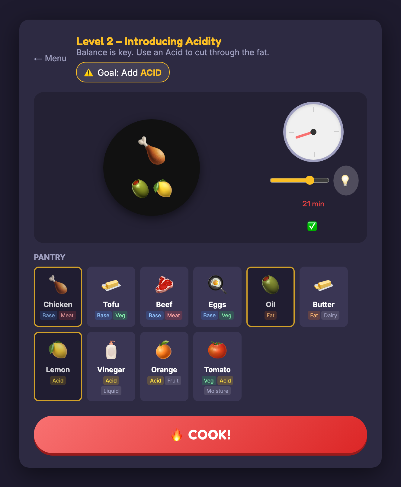

# First Kitchen — Cooking Game

**Master the art of heat, ingredients, and timing.**

**[Play Now](https://nithish101.github.io/first-kitchen/)**

First Kitchen is an interactive cooking game where you learn by experimenting. There are no recipes—only logic. Can you find the perfect balance?

| | |
|---|---|
|  |  |
| Pick ingredients and set the cooking time | Scored on taste, texture and doneness |

## 🍳 How to Play

### 1. The Kitchen
Select a **Base Ingredient** (like Chicken 🍗 or Tofu 🧈) to start your dish. Each ingredient has unique properties:
-   **Fat**: Adds richness but needs balance.
-   **Acid**: Brightens flavors (Lemon 🍋, Tomato 🍅).
-   **Moisture**: Affects texture and cooking speed.
-   **Density**: Determines how long it takes to cook.

### 2. Cooking Time
Use the slider (0–30 Minutes) to set your cooking time.
-   **Strategic Timing**: Different bases need different times.
-   **Modifiers**: Adding Oil might speed things up; adding Tomatoes might slow them down.
-   **Safety First**: Be careful! Undercooking meat (like Chicken) can lead to food poisoning and instant failure. 🚫

### 3. The Result
After cooking, you'll be judged on four metrics:
-   **Taste**: Is the Fat/Acid balance correct?
-   **Texture**: Did you cook it long enough for the moisture content?
-   **Doneness**: Is it raw, perfect, or burnt? 
-   **Dietary Constraints**: Does it meet the level's specific rule (e.g., Vegetarian)?

### 4. Scoring
Earn up to **3 Stars** ⭐ per level.
-   **Pass**: You need at least **2 Stars** to unlock the next level.
-   **Perfect Window**: Get within **±2 minutes** of the ideal time for a perfect score.

## 💡 Need a Hint?
Stuck on a level? Click the **💡 Lightbulb** button next to the timer. A dynamic arrow will guide you toward the perfect cooking time.

## 🛠️ Technology
Built with vanilla **HTML5**, **CSS3**, and **JavaScript**. No frameworks, just pure logic and physics-based interactions.
